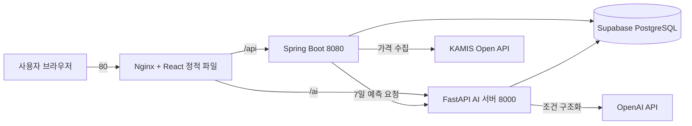

# MealFit · 밀핏

향후 식재료 가격 변동을 예측해, 예산 안에서 안정적으로 운영할 수 있는 급식 메뉴를 제안하는 서비스

**Spring Boot · React · FastAPI · PostgreSQL(pgvector) · LangGraph · Docker · AWS**

**프로젝트 기간** 2026.09.10 ~ 2026.10.14

https://mealfit.duckdns.org/

---

## 프로젝트 소개

MealFit은 단체급식 운영자가 가격 변동에 선제적으로 대응할 수 있도록 돕는 데이터 기반 급식 관리 서비스입니다.

식재료 가격은 기상 이변과 유통 환경에 따라 단기간에 30~80%까지 오르내립니다. 식단을 확정한 뒤 실제 납품 시점에 가격이 오르면 예산을 넘기기 쉽고, 원가 계산과 대체 메뉴 탐색도 수기로 처리해야 합니다.

MealFit은 과거 가격 이력으로 **향후 7일의 식재료 가격과 가격 상승 위험을 예측**하고, 이를 메뉴 원가와 예산 분석에 연결해 **위험 메뉴 탐지부터 대체 메뉴 추천까지 하나의 흐름**으로 제공합니다.

### 차별점

| 구분 | 밥짜 (bazza) | 누비랩 AI 푸드 스캐너 | **MealFit** |
|---|---|---|---|
| 핵심 방식 | 생성형 AI 기반 | 비전 AI 기반 | ML · RAG · LLM 하이브리드 |
| 가격(단가) 예측·관리 | 미지원 / 단순 참고 | 사후 간접 절감 | **지원 / 사전 제어** |
| 주요 초점 | 사전 기획 · 예산 최적화 | 사후 관리 · 낭비 방지 | 사전 자동화 |
| 도입 | 전용 하드웨어 없음 | 전용 하드웨어 필요 없음 | 전용 하드웨어 없음 |

---

## 주요 기능

- **식재료 가격 수집·전처리**
  - KAMIS(농축수산물 공공 API) 가격을 주기적으로 수집
  - 단위 정규화, 중복 저장 방지, 결측 처리

- **7일 가격 예측 · 가격 위험 분석**
  - 품목별 향후 7일 평균가·최고가 예측
  - 예측 상승률과 최근 변동성을 결합한 위험 점수 산출 및 위험 식재료 식별

- **메뉴 원가 · 예산 분석**
  - 현재 단가와 예측 단가 기준의 1인분 원가, 총 급식 원가, 주간 예상 비용 계산
  - 월 예산 대비 사용률과 초과 위험 판단, 고비용 메뉴 탐지

- **주간 식단 편성 · 재평가 · 대체 메뉴 추천**
  - 주간 식단 편성, 저장, 메뉴 교체
  - 가격·다양성·원가를 고려한 대체 메뉴 후보 추천과 변경 전후 비용 비교

- **AI 메뉴 추천 챗봇**
  - 자연어 질문을 검색 조건으로 변환하고, 의미 기반 검색(RAG)으로 메뉴 후보를 찾은 뒤 가격·영양·안전 조건 검증

- **회원 · 시설 · 운영 관리**
  - 회원가입·로그인, 역할별 접근 제어(USER · MANAGER · ADMIN)
  - 시설 기본정보, 식사별 인원, 1인 목표 식재료비, 월 예산 관리
  - 관리자 시스템 상태 점검(백엔드·DB·가격 수집·KAMIS·AI 서버)과 오류 로그 확인

### 기대 효과

- **예산 절감 · 적자 방지**: 가격 급등 위험 식재료를 사전에 배제·대체해 예산 초과 방지
- **업무 효율화**: 품목별 원가 계산과 대체 식재료 조사를 자동화해 수기 계산 업무 감소
- **운영 안정화**: 발주 직전 급한 식단 수정과 현장 혼선 감소
- **급식 품질 유지**: 무리한 식단 축소 없이 가성비와 영양이 균형 잡힌 대체 메뉴 선택

---

## 기술 스택

| 구분 | 기술 |
|---|---|
| Frontend | React 19, Vite, React Router, Axios, HTML/CSS/JavaScript |
| Backend | Java 17, Spring Boot, Spring Security(JWT), JPA, MyBatis, Gradle |
| AI Server | Python 3.12, FastAPI, Uvicorn |
| ML / DL | Scikit-learn(Ridge), XGBoost, LightGBM, pandas, NumPy |
| LLM / RAG | OpenAI API, BGE-M3 임베딩, pgvector, LangChain, LangGraph, MCP |
| Database | PostgreSQL (Supabase) |
| CI / CD | GitHub Actions, Docker, Docker Compose, Amazon ECR |
| Infra | AWS EC2, IAM(OIDC), Systems Manager, Nginx |
| Collaboration | Git, GitHub, Jira, Slack |

### 주요 구현 기술

- **7일 가격 예측**: 서울·부산·대전 일별 가격을 대표가격으로 만들고, 시간 순서를 지키는 4구간 롤링 백테스트로 모델을 비교해 Ridge 회귀 2종(7일 평균가·최고가)을 운영 모델로 선정
- **가격 위험 점수**: 예측 상승률과 최근 상대 변동성을 각각 0~1 점수(백분위)로 바꿔 평균하고, 기준 0.75 이상을 위험으로 분류
- **정밀 원가 연산**: `BigDecimal` 기반 1인 단가 계산으로 금액 오차 방지
- **멀티 시설 데이터 격리**: JWT와 시설(`facility_id`) 기준 처리로 시설 간 데이터 분리
- **장애 격리**: 외부 가격 API·AI 서버 장애가 원가·예산 등 비AI 기능으로 번지지 않도록 예외 처리와 Fallback 구성
- **AI 메뉴 추천**: LLM 조건 구조화 → RAG 의미 검색 → LangGraph 검증 흐름 → MCP Tool 호출
- **자동 배포**: GitHub Actions → ECR → SSM 배포, OIDC 임시 권한으로 장기 키 미사용

---

## 시스템 아키텍처



| 구성 | 역할 |
|---|---|
| Frontend (React) | 식단 편성, 원가·예산 분석, 가격 예측, AI 챗봇 화면 |
| Backend (Spring Boot) | 인증·권한, 시설·식단 API, 원가·예산 계산, KAMIS 수집·예측 스케줄링 |
| AI Server (FastAPI) | 7일 가격 예측, 위험 점수 산출, 자연어 메뉴 검색(RAG), 비용 위험 분류 |
| Database (Supabase) | 사용자·시설·메뉴·식단·가격·예측 데이터 저장, 벡터 검색(pgvector) |

### 서비스 흐름

```text
KAMIS 가격 수집
    ↓
가격 정규화 · DB 저장
    ↓
AI 서버 7일 가격 예측 · 위험 점수 산출
    ↓
메뉴 1인분 원가 · 주간 예상 비용 계산 (현재·예측 단가)
    ↓
예산 사용률 · 초과 위험 판단 · 고비용 메뉴 탐지
    ↓
대체 메뉴 후보 추천 · 식단 수정 · 비용 재계산
```

---

## 프로젝트 구조

```text
MealFit/
├── backend/                 # Spring Boot 백엔드
│   └── src/main/java/com/human/backend/
│       ├── auth · member · facility    # 인증·회원·시설
│       ├── price · prediction          # 가격 수집·예측 연동
│       ├── cost · budget · automation  # 원가·예산·재평가
│       ├── mealplan · menu · ingredient
│       ├── recommendation · search · chat
│       ├── admin · errorlog · integration
│       └── scheduling                  # 정기 실행·서버 재시작 누락 보정
│
├── frontend/                # React + Vite 프론트엔드
│   └── src/features/        # 기능별 모듈 (budget, mealplan, menu, price, chat …)
│
├── ai-server/               # FastAPI AI 서버
│   ├── app/
│   │   ├── api/routes/      # 메뉴 검색, 가격 예측, 비용 위험 분류 API
│   │   ├── prediction/      # 7일 예측 · 위험 점수 추론
│   │   ├── rag/             # 질의 구조화, 임베딩, 벡터 검색
│   │   └── agent/           # LangGraph 워크플로우, MCP
│   ├── training/price/      # 가격 예측 데이터셋 생성·모델 비교 스크립트
│   └── artifacts/           # 학습된 모델 파일
│
├── .github/workflows/       # GitHub Actions (빌드 검증, ECR 푸시·배포)
├── .env.example             # 환경변수 예시
└── README.md
```

---

## CI / CD 및 배포

```text
GitHub Push
    ↓
GitHub Actions  ─ Docker 이미지 3종 빌드 (frontend / backend / ai)
    ↓
Amazon ECR      ─ 커밋 SHA 태그로 이미지 저장
    ↓
SSM Run Command ─ EC2에 배포 명령 전달
    ↓
AWS EC2         ─ Docker Compose로 컨테이너 3개 실행, Supabase DB 사용
```

- `Docker Build Test` : `main` 대상 Pull Request · Push 시 이미지 빌드 성공 여부 검증
- `Build and Push to ECR` : `main` Push 시 ECR 푸시와 EC2 배포까지 자동 수행
- 보안: GitHub OIDC로 IAM 역할을 위임받아 장기 액세스 키를 저장하지 않음
- 버전 관리: 커밋 SHA를 이미지 태그로 사용해 이전 버전으로 되돌릴 수 있음

---

## 팀원 및 역할

| 팀원 | 담당 영역 |
|---|---|
| 정현식 | 회원 인증·권한 관리, 시설 프로필 설정, 시스템 모니터링, 배포·CI/CD |
| 배민선 | 식재료 시계열 가격 수집·정제, 7일 가격 예측·위험도 분석 엔진 |
| 박재은 | LLM 기반 자연어 질의, RAG 하이브리드 검색, LangGraph·MCP 연동 |
| 이제형 | 예측 단가 기반 메뉴 슬롯 원가 계산, 주간 식단 재구성·대체 메뉴 추천 |
| 최주원 | 메뉴 원가 산출, 예산 초과 위험 탐지, 주간 식단 재평가 로직 |

---

## 로컬 실행 방법

### 사전 준비

- JDK 17, Node.js 24, Python 3.12
- Supabase(PostgreSQL) 접속 정보 — `pgvector` 확장과 `mealfit` 스키마가 준비된 DB

### 1. 저장소 복제

```bash
git clone https://github.com/sodacandy12-ux/MealFit.git
cd MealFit
```

### 2. 환경변수 설정

`.env.example`을 복사해 `.env`를 만들고 값을 입력합니다. `.env`는 Git에 올리지 않습니다.

```bash
cp .env.example .env
```

| 변수 | 설명 |
|---|---|
| `DB_URL` · `DB_USERNAME` · `DB_PASSWORD` | PostgreSQL 접속 정보 (Backend·AI 서버 공통) |
| `JWT_SECRET` | JWT 서명용 32바이트 이상 무작위 문자열 |
| `AI_SERVER_URL` | Backend가 호출할 AI 서버 주소 (기본 `http://localhost:8000`) |
| `BACKEND_URL` | AI 서버가 원가 API를 호출할 Backend 주소 (기본 `http://localhost:8080`) |
| `KAMIS_API_KEY` · `KAMIS_CERT_ID` | KAMIS 가격 수집 시 필요 (없어도 서버는 실행됨) |
| `OPENAI_API_KEY` | AI 메뉴 추천 챗봇의 자연어 조건 구조화에 필요 |

### 3. Backend 실행

```bash
cd backend
./gradlew bootRun        # Windows: gradlew.bat bootRun
```

```text
http://localhost:8080/api/health
```

### 4. AI 서버 실행

```bash
cd ai-server
python -m venv .venv
.venv\Scripts\activate   # macOS / Linux: source .venv/bin/activate
pip install -r requirements.txt
uvicorn app.main:app --reload --port 8000
```

최초 실행 시 BGE-M3 임베딩 모델을 내려받습니다.

```text
http://localhost:8000/api/health
```

### 5. Frontend 실행

로컬 개발에서는 API 주소를 지정합니다. `frontend/.env.local`을 만들어 입력하세요.

```text
VITE_API_BASE_URL=http://localhost:8080
VITE_AI_API_URL=http://localhost:8000
```

```bash
cd frontend
npm install
npm run dev
```

```text
http://localhost:5173
```

### 6. 테스트

```bash
cd backend
./gradlew test
```

---

## 향후 개선 방향

- **예측 범위 확대**: 아열대 작물 등 품목을 넓히고, 7일 외에 30일 등 예측 기간을 다양화
- **모델 고도화**: 피처 보강과 딥러닝(LSTM·GRU) 비교 검증, 예측 오차 추적과 재학습
- **추천 고도화**: 예산·가격 위험 기반 후보 순위화, 영양·알레르기 기준 데이터를 반영한 제약 조건 추가, Advanced RAG 적용
- **운영 안정화**: 수집·예측 실패 알림과 재시도, 테스트 자동 실행(CI) 확장, 가격 급등·예산 초과 시나리오 전 구간 검증
